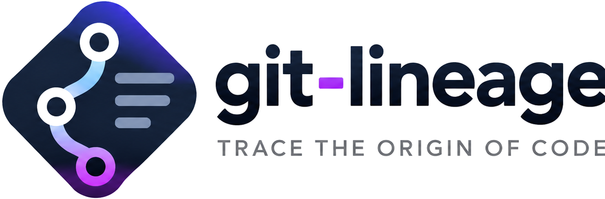

# git-lineage

<div align="center">



<h3>The Codebase Archaeology CLI and Agent Forensic Primitive</h3>

<p>
  <strong>Uncover why code was written, how it evolved, and the human decisions behind it—without the noise.</strong>
</p>

[](https://github.com/NayanSrivastav/git-lineage/actions)
[](https://www.rust-lang.org)
[](LICENSE)
[](CONTRIBUTING.md)

[Quickstart](#quickstart) •
[Why AI Agents Need Lineage](#why-ai-agents-need-code-provenance) •
[Why Not `git blame`?](#why-not-git-blame) •
[Features](#features) •
[Architecture](#architecture) •
[Agent Integration](#agent-integration--mcp-protocol) •
[Contributing](#contributing)

</div>

---

## The Core Problem

### For Human Developers: The Dead-End `git blame`
It is 4:00 PM on a Tuesday. You are reviewing unfamiliar legacy code in your payments service:

```typescript
// src/billing/stripe_webhook.ts
if (event.id.startsWith("evt_test_") && payload.attempt > 1) {
  return 200; // Why is this check here? Is it safe to delete?
}
```

You run standard `git blame`:
```text
a3f89b1 Bob 2024-02-10 "refactor: run prettier across billing"
```

**Dead end.** Bob left the company two years ago, and the commit was an automated formatting pass that touched 800 files.

To find the truth, you must now:
1. Run `git log -S "evt_test_" -p` to hunt through raw diffs.
2. Step through merge commits and file renames.
3. Search GitHub for the original Pull Request.
4. Read closed issues and reviewer comments to understand the edge case.

**Result: 40 minutes of cognitive drain for a 3-line check.**

---

### For AI Coding Agents: The Silent Regression Trap
Autonomous AI coding agents (**Claude Code**, **Cursor**, **Devin**, **Codex**) are increasingly tasked with refactoring, modernizing, and optimizing codebases.

However, **code without history is an incomplete prompt**:
* An agent only sees the *static syntax* of the current file at `HEAD`.
* When an agent sees an obscure defensive condition, retry loop, or rate limiter, it lacks the historical rationale.
* The agent considers it "redundant" or "unidiomatic", refactors it away, and **silently reintroduces a production bug** that was resolved two years ago after a grueling postmortem.
* Standard unit tests often fail to catch these edge cases because the regression only manifests under rare production constraints.

> **The Pre-Refactoring Safety Invariant:**  
> Before modifying or deleting legacy code, an agent must query `git-lineage` to uncover the historical constraints, linked issues, and reviewer decisions that brought that code into existence.

---

## The Solution: `git lineage`

Run `git-lineage` directly on the file and line:

```bash
git lineage src/billing/stripe_webhook.ts:88
```

Within **sub-second time**, `git-lineage` traverses parent commits, tracks code across moves and renames, correlates the true commit with GitHub PR discussions, and outputs an archaeological dossier:

```text
╭─ Lineage: src/billing/stripe_webhook.ts:88 ───────────────────────────────────────╮
│ › if (event.id.startsWith("evt_test_") && payload.attempt > 1) { return 200; }     │
╰───────────────────────────────────────────────────────────────────────────────────╯

📌 Genesis (Introducing Commit)
   Commit:    e819b2c (2022-04-12, 2 years ago)
   Author:    Sarah Chen <sarah@acme.dev>
   PR:        #412: "Handle duplicate sandbox webhook retries from Stripe API v2"
   Intent:    "Stripe test-mode webhooks retry up to 5x even on 200 in sandbox when
               fixtures take >2s. This prevents infinite retry storms in CI."

📜 Evolution Timeline
   ● 2023-08-19  904ab12  (#904)
     refactor: migrate webhook handlers to billing service
   ★ 2022-04-12  e819b2c  (#412)
     feat: handle duplicate sandbox webhook retries from Stripe API v2

🧪 Evidence & Confidence
   Related Tests: tests/billing/stripe_webhook.test.ts
   PR URL:        https://github.com/acme/payment/pull/412
   Linked Issues: #398
   Review Note:   alex: "Make sure this check only triggers on attempt > 1 so first attempt errors alert."
   Confidence:    High (Explicit PR / reviewer rationale verified)
```

---

## Why Not Existing Tools?

| Capability | `git blame` | `git log -S` | GitLens (VS Code) | `git-lineage` |
| :--- | :---: | :---: | :---: | :---: |
| **Bypasses formatting / lint noise** | ❌ | ❌ | Partial (`-w`) | **Yes (Automatic `-w` & DAG walk)** |
| **Follows code across file renames** | ❌ | Complex (`--follow`) | ❌ | **Yes (Automatic DAG tracking)** |
| **Surfaces PR rationale & discussions** | ❌ | ❌ | Yes (GUI only) | **Yes (Terminal, Markdown & JSON)** |
| **Multi-origin block dissection** | ❌ | ❌ | ❌ | **Yes (Isolates multi-commit lines)** |
| **Locates companion test cases** | ❌ | ❌ | ❌ | **Yes (Heuristic test matcher)** |
| **Machine-readable for AI agents** | ❌ | ❌ | ❌ | **Yes (`--json` MCP-ready)** |
| **Runtime footprint** | Built-in | Built-in | Heavy (Node/Electron) | **Single static binary (<8MB)** |

---

## Quickstart

### Installation

#### macOS (Homebrew)
```bash
brew install NayanSrivastav/tap/git-lineage
```

#### Linux & macOS (Universal Script)
```bash
curl -fsSL https://raw.githubusercontent.com/NayanSrivastav/git-lineage/main/install.sh | sh
```

#### From Source (Rust toolchain)
```bash
cargo install git-lineage
```

### Basic Commands

```bash
# Trace a specific line
git lineage src/billing/stripe_webhook.ts:88

# Trace a block of lines
git lineage src/billing/stripe_webhook.ts:80-120

# Export clean Markdown for PR reviews or discussions
git lineage src/billing/stripe_webhook.ts:88 --md

# Machine-readable JSON output for AI agents
git lineage src/billing/stripe_webhook.ts:88 --json
```

---

## Features

### 1. True Genesis Detection & DAG Traversal
Standard `git blame` stops at the most recent commit touching a line. `git-lineage` traverses parent commits backward through the Git revision DAG, ignoring whitespace deltas (`-w`), mass code formatting commits, and file moves (`-C`, `-M`) until it isolates the **true introducing commit**.

### 2. Multi-Origin Block Dissection
When querying a multi-line range, different lines frequently originate from different commits. Rather than falsely attributing the entire block to line 1's commit, `git-lineage` dissects the block into contiguous slices and reports the genesis commit for each slice:
```text
🧩 Multi-Origin Range (2 distinct introducing commits):
   Lines 80-85: 5b2004f by Sarah Chen (2 years ago) — "introduce sandbox guard"
   Lines 86-90: 904ab12 by Marcus Vance (1 year ago) — "add exponential backoff"
```

### 3. Context & Discussion Mining
Code commits tell you *what* changed; Pull Requests tell you *why*. `git-lineage` queries your local `gh` CLI credentials to surface:
* PR title and substantive description excerpt.
* Linked issue references (`fixes #398`, `resolves #412`).
* Key discussion comments and review constraints from collaborators.

### 4. Zero-Hallucination Confidence Engine
`git-lineage` strictly separates verifiable **Facts** from **Inferences**:
* `[High: Explicit]`: Substantive PR description or reviewer constraints verified.
* `[Medium: Inferred]`: Derived from commit message body and diff patterns.
* `[Low: None]`: No rationale recorded in commit or PR history. **It never invents reasons.**

---

## Agent Integration & MCP Protocol

AI coding agents use the `--json` flag to retrieve deterministic, structured provenance before modifying code:

```bash
git lineage src/billing/stripe_webhook.ts:88 --json
```

### Structured Output Schema

```json
{
  "file_path": "src/billing/stripe_webhook.ts",
  "line_range": "88",
  "code_snippet": "if (event.id.startsWith(\"evt_test_\") && payload.attempt > 1) { return 200; }",
  "genesis_commit": {
    "sha": "e819b2c8d23fa89b21a81234901f4c78129034aa",
    "short_sha": "e819b2c",
    "author_name": "Sarah Chen",
    "author_email": "sarah@acme.dev",
    "author_date": "2022-04-12 14:22:10",
    "subject": "feat: handle duplicate sandbox webhook retries from Stripe API v2",
    "body": "Stripe test-mode webhooks retry up to 5x even on 200 in sandbox when fixtures take >2s."
  },
  "origins": [
    {
      "line_start": 88,
      "line_end": 88,
      "genesis_sha": "e819b2c8d23fa89b21a81234901f4c78129034aa",
      "short_sha": "e819b2c",
      "author": "Sarah Chen",
      "date": "2022-04-12 14:22:10",
      "summary": "feat: handle duplicate sandbox webhook retries from Stripe API v2"
    }
  ],
  "pr_reference": "#412",
  "pr_details": {
    "number": 412,
    "title": "Handle duplicate sandbox webhook retries from Stripe API v2",
    "url": "https://github.com/acme/payment/pull/412",
    "body_summary": "Stripe test-mode webhooks retry up to 5x even on 200 in sandbox when fixtures take >2s.",
    "reviewer_highlights": [
      "alex: \"Make sure this check only triggers on attempt > 1 so first attempt errors alert.\""
    ],
    "linked_issues": ["#398"]
  },
  "intent_summary": "Handle duplicate sandbox webhook retries from Stripe API v2: Stripe test-mode webhooks retry up to 5x...",
  "confidence": "explicit",
  "related_tests": ["tests/billing/stripe_webhook.test.ts"],
  "evolution": [
    {
      "date": "2023-08-19 11:05:22",
      "commit_sha": "904ab12...",
      "short_sha": "904ab12",
      "author": "Marcus Vance",
      "summary": "refactor: migrate webhook handlers to billing service",
      "pr_reference": "#904",
      "is_genesis": false
    },
    {
      "date": "2022-04-12 14:22:10",
      "commit_sha": "e819b2c...",
      "short_sha": "e819b2c",
      "author": "Sarah Chen",
      "summary": "feat: handle duplicate sandbox webhook retries from Stripe API v2",
      "pr_reference": "#412",
      "is_genesis": true
    }
  ]
}
```

---

## Privacy & Security

* **100% Local Git Processing:** All DAG traversal and blame analysis happens locally on your machine.
* **Local CLI Authentication:** Remote GitHub queries use your local authenticated `gh` session. No tokens are sent to third-party servers.
* **Zero Telemetry:** No tracking, analytics, or background network calls.

---

## Contributing

We welcome contributions from engineers who care about developer tooling and software forensics!
Please read our [Contributing Guide](CONTRIBUTING.md) and [Development Guidelines](DEVELOPMENT.md) before submitting pull requests.

---

## License

This project is licensed under the [MIT License](LICENSE).
